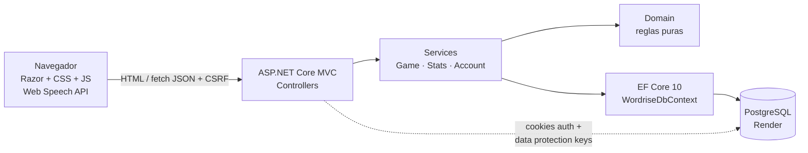
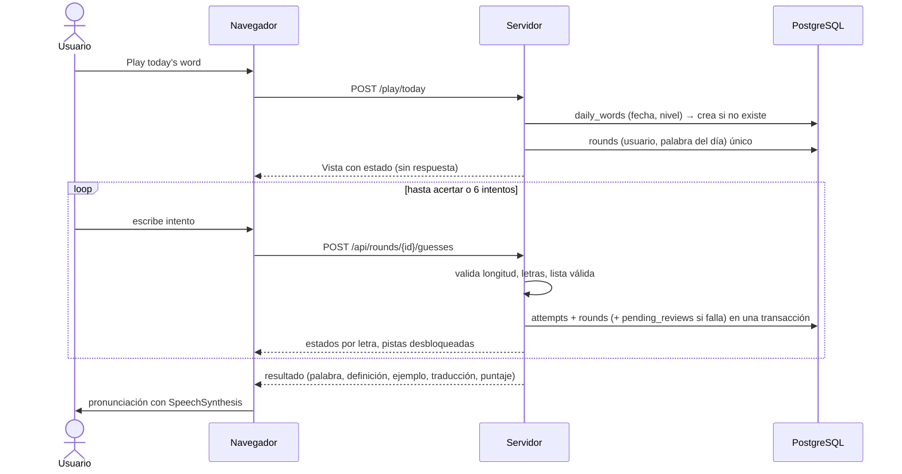
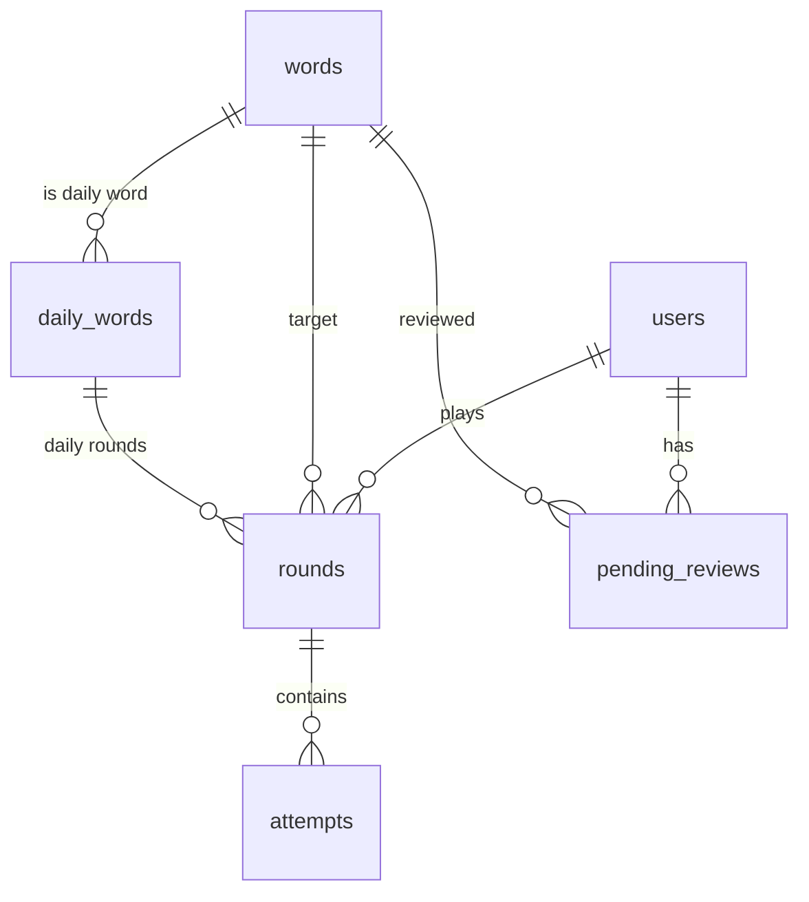
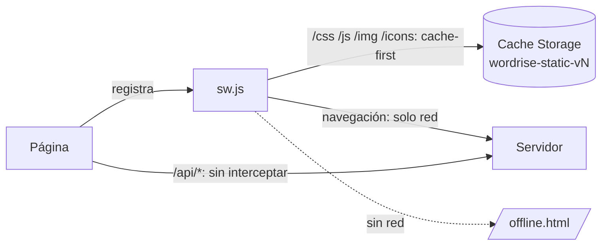

# Wordrise — Arquitectura

## Componentes

Aplicación monolítica ASP.NET Core MVC de tres capas (interfaz, lógica, datos), desplegada como un contenedor Docker en Render.

- `Domain/Game`: lógica sin dependencias (evaluación de intentos, pistas, puntaje, selección diaria, campamentos, repetición espaciada). Probada con pruebas unitarias.
- `Services`: casos de uso; únicos que usan `WordriseDbContext`.
- `Controllers`: MVC para páginas; `RoundsApiController` (`/api/rounds/{id}`, `/guesses`, `/hints`) para la ronda.

## Flujo de una ronda

## Modelo de datos

| Tabla | Columnas principales | Restricciones |
|---|---|---|
| `users` | id, name, email, password_hash, level, pronunciation_audio_enabled, created_at | email único y en minúsculas; level ∈ {A2,B1,B2} |
| `words` | id, text, level, part_of_speech, definition_en, example_sentence, translation_es, is_daily_answer | text único, `^[a-z]{4,10}$`; índice (level, is_daily_answer) |
| `daily_words` | id, date, level, word_id | único (date, level); FK word RESTRICT |
| `rounds` | id, user_id, mode, daily_word_id?, word_id, played_on, status, attempts_used, hints_unlocked, manual_hints_used, score, started_at, finished_at | único (user_id, daily_word_id) parcial; checks de rangos y coherencia mode/daily_word_id; FK user CASCADE, word/daily_word RESTRICT |
| `attempts` | id, round_id, number, guess_text, feedback, created_at | único (round_id, number); FK round CASCADE |
| `pending_reviews` | id, user_id, word_id, stage, next_review_on, last_missed_on | único (user_id, word_id); índice (user_id, next_review_on); FK user CASCADE, word RESTRICT |
| `data_protection_keys` | id, friendly_name, xml | Claves de cookies persistentes entre despliegues |

Las estadísticas se calculan desde `rounds` (sin tablas adicionales). Fechas de juego: `date` en zona `America/Mexico_City`; instantes: `timestamptz` en UTC.

## Seguridad

- Contraseñas con `PasswordHasher<T>` (PBKDF2 con sal). Mensaje genérico ante credenciales inválidas.
- Cookie `HttpOnly`, `SameSite=Lax`; antiforgery global (formularios y header `X-CSRF-TOKEN` en `fetch`).
- Cada consulta de ronda filtra por `user_id` del usuario autenticado (sin IDOR).
- Rate limiting: 10/min por IP en login/registro; 60/min por usuario en la API de rondas.
- La respuesta nunca se envía al cliente mientras la ronda está en curso.

## PWA

Detalle y alternativas en `docs/adr/0002-pwa-caching.md`. No se guardan HTML autenticado ni respuestas de la API.
